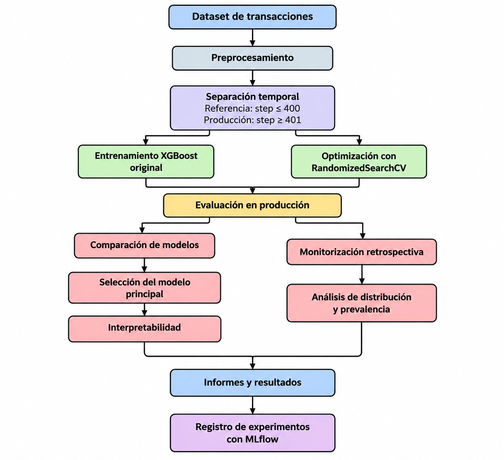

[# Detección de transacciones fraudulentas con Machine Learning

## 1. Descripción del proyecto

Este proyecto desarrolla un modelo de Machine Learning para identificar transacciones financieras fraudulentas a partir de un conjunto de datos de aproximadamente 6,36 millones de transacciones. Se utiliza XGBoost para entrenar y evaluar modelos, optimizar hiperparámetros y analizar su rendimiento sobre un periodo temporal independiente.

El proyecto incorpora seguimiento de experimentos con MLflow, interpretación del modelo y análisis de cambios en la distribución de los datos.

## 2. Objetivos

- Desarrollar un modelo de clasificación para detectar transacciones fraudulentas.
- Optimizar los hiperparámetros mediante RandomizedSearchCV.
- Evaluar el rendimiento con métricas apropiadas para clases desbalanceadas.
- Interpretar la importancia de las variables predictoras.
- Analizar cambios en la distribución de los datos y en la prevalencia del fraude.
- Registrar experimentos y resultados con MLflow.

## 3. Fuente de datos

El conjunto de datos se obtuvo de Kaggle:

[Conjunto de datos de transacciones financieras para detección de fraude](https://www.kaggle.com/datasets/charlesbeauchamp/ps-20174392719-1491204439457-logcsv?resource=download)

- **Archivo:** `dataset_proyecto.csv`
- **Registros:** 6.362.620 transacciones.
- **Variables:** 11.
- **Variable objetivo:** `isFraud`.

La variable objetivo identifica si una transacción es fraudulenta. El conjunto presenta un fuerte desbalance entre transacciones legítimas y fraudulentas.

## 4. Flujo de trabajo

El proyecto sigue un flujo de trabajo de Machine Learning que abarca desde la preparación de los datos hasta la evaluación temporal y la monitorización retrospectiva.

### Etapas principales

1. **Preprocesamiento:** preparación de variables y transformación de variables categóricas.
2. **Entrenamiento:** desarrollo del modelo original y optimización de hiperparámetros.
3. **Evaluación:** comparación de ambos modelos en el periodo temporal de producción.
4. **Interpretabilidad:** análisis de la importancia de las variables.
5. **Monitorización:** comparación retrospectiva de las distribuciones y de la prevalencia del fraude.
6. **Trazabilidad:** registro de experimentos, métricas y artefactos mediante MLflow.

## 5. Estrategia de evaluación temporal

Los datos se separaron según la variable temporal `step`:

- **Referencia y entrenamiento:** `step <= 400`, con 5.787.030 transacciones.
- **Producción y evaluación:** `step >= 401`, con 575.590 transacciones.

El periodo de producción se mantuvo separado del entrenamiento y de la búsqueda de hiperparámetros para evaluar la capacidad de generalización temporal de los modelos.

## 6. Optimización de hiperparámetros

Se utilizó RandomizedSearchCV con seis configuraciones, validación cruzada estratificada de tres particiones y una muestra de 200.000 transacciones del periodo de entrenamiento.

La métrica utilizada para seleccionar la configuración fue Average Precision.

Los mejores hiperparámetros encontrados fueron:

- `n_estimators`: 150
- `max_depth`: 3
- `learning_rate`: 0.1
- `min_child_weight`: 5
- `subsample`: 1.0
- `colsample_bytree`: 1.0

El modelo optimizado se entrenó posteriormente con el conjunto completo de referencia.

## 7. Resultados de evaluación

Los modelos se evaluaron en el periodo de producción con un umbral de clasificación de 0,5.

| Métrica | XGBoost original | XGBoost optimizado |
|---|---:|---:|
| Average Precision (PR-AUC) | 0,9726 | 0,9516 |
| ROC-AUC | 0,9998 | 0,9996 |
| Precisión de fraude | 0,5714 | 0,2796 |
| Recall de fraude | 0,9971 | 0,9997 |
| Falsas alarmas | 2.794 | 9.621 |
| Fraudes no detectados | 11 | 1 |

El modelo original obtuvo mejores resultados en Average Precision y precisión de fraude, además de generar menos falsas alarmas. El optimizado alcanzó un recall ligeramente superior, a costa de incrementar las falsas alarmas.

Por estos resultados, se conserva el modelo original como modelo principal del proyecto.

## 8. Interpretabilidad

Se analizó la importancia de las variables del modelo XGBoost para identificar cuáles contribuyen más a sus predicciones. Los resultados se presentan en `reports/importancia_variables.png`.

La importancia del modelo describe su comportamiento predictivo y no debe interpretarse como evidencia de causalidad.

## 9. Monitorización

Se realizaron análisis retrospectivos para comparar los periodos de referencia y producción:

- Distancia de Wasserstein para comparar las distribuciones de seis variables numéricas.
- Comparación de la prevalencia del fraude entre periodos.
- Evaluación de métricas de clasificación en el periodo de producción.

La prevalencia del fraude aumentó de 0,0774 % en referencia a 0,6491 % en producción. Este cambio constituye una señal que requiere seguimiento, pero no demuestra por sí solo la existencia de concept drift ni un deterioro del modelo.

La monitorización implementada corresponde a un análisis retrospectivo; no constituye todavía un sistema automatizado de monitorización en tiempo real.

## 10. Seguimiento de experimentos con MLflow

Se utilizó MLflow para registrar y consultar los experimentos asociados al desarrollo del sistema de detección de transacciones fraudulentas.

El experimento principal se denomina `deteccion_fraude` e incluye ejecuciones relacionadas con la búsqueda de hiperparámetros, la comparación de modelos, el registro de artefactos y la monitorización.

Los elementos registrados incluyen:

- **Modelo de producción:** `xgboost_fraude.joblib`.
- **Preprocesador:** `preprocessor.joblib`.
- **Modelo optimizado:** `xgboost_fraude_optimizado.joblib`.
- **Métricas de evaluación:** Average Precision, ROC-AUC, precisión y recall para fraude, falsas alarmas y fraudes no detectados.
- **Artefactos de monitorización:** `metricas_produccion.csv`, `data_drift_wasserstein.csv`, `prevalencia_fraude.csv` e `informe_monitorizacion.html`.

La evidencia de ejecución se obtuvo mediante la interfaz de MLflow, donde se verificaron los experimentos, sus métricas y los artefactos registrados.

La base de datos de seguimiento de MLflow y sus archivos internos se almacenan localmente y no se incluyen directamente en el repositorio. Por tanto, la interfaz local no constituye un enlace público de consulta.

**Limitación:** para que un evaluador pueda explorar los experimentos directamente, sería necesario publicar o compartir el seguimiento de MLflow mediante una plataforma accesible externamente. Mientras tanto, el repositorio incluye los informes y resultados necesarios para consultar los principales hallazgos.

## 11. Estrategia de control de versiones

Se utilizó GitHub para gestionar las versiones del proyecto y organizar la integración de cambios.

- **`main`:** rama principal que contiene la versión estable del proyecto.
- **`development`:** rama de trabajo para incorporar y revisar modificaciones antes de integrarlas en la rama principal.
- **Pull Requests:** se utilizaron para integrar los cambios entre ramas y mantener un historial de las modificaciones.
- **Versión `v1.0.0`:** se publicó una versión inicial del proyecto mediante una release de GitHub.

La integración de cambios se realizó mediante Pull Requests entre `main` y `development`, con el objetivo de mantener trazabilidad y separar el desarrollo de la versión estable.

## 12. Estructura del repositorio

- `notebooks/`: cuadernos de preprocesamiento, entrenamiento, interpretabilidad y monitorización.
- `data/`: documentación y enlace de acceso al conjunto de datos.
- `models/`: modelos entrenados y preprocesador.
- `reports/`: métricas, gráficos e informe HTML de monitorización.
- `requirements.txt`: dependencias de Python.
- `.gitignore`: archivos excluidos del control de versiones.

## 13. Requisitos y reproducibilidad

Se requiere Python y las bibliotecas indicadas en `requirements.txt`. Para reproducir los análisis, descarga el conjunto de datos desde Kaggle y coloca `dataset_proyecto.csv` en el directorio `data/`.

Los notebooks deben ejecutarse siguiendo el orden numérico indicado en sus nombres.

## 14. Limitaciones

- La evaluación se realizó sobre un único periodo temporal de producción.
- La optimización se realizó sobre una muestra del conjunto de entrenamiento.
- El umbral de clasificación se fijó en 0,5 para comparar los modelos.
- Los análisis de distribución no constituyen por sí solos una detección concluyente de concept drift.
- La monitorización no está automatizada en tiempo real.](http://localhost:5000)

## 15. Tecnologías utilizadas

Python, pandas, Polars, NumPy, scikit-learn, XGBoost, SciPy, Matplotlib, Joblib, MLflow y Jupyter Notebook.

La evidencia visual del seguimiento de experimentos con MLflow se encuentra en `reports/evidencia_mflow_monitorizacion.png`. La captura documenta la interfaz local de MLflow y los artefactos registrados durante la evaluación y monitorización del modelo.
